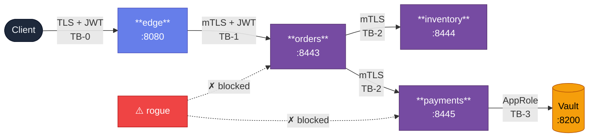
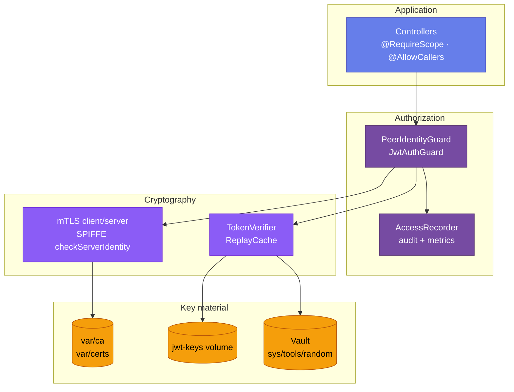

<div align="center">

<a href="https://github.com/Abdulgeni/bastion">
  
</a>

<a href="https://git.io/typing-svg">
  
</a>

<br/>


<br/><br/>


<br/><br/>


</div>

---

<div align="center">

### 🌐 [Overview](#-overview) · 🏛 [Architecture](#-architecture) · ✨ [Features](#-features) · 🚀 [Quick Start](#-quick-start) · 🎬 [Demos](#-demos) · 🔒 [Security](#-security-model) · 🛡 [Security Pipeline](#-security-pipeline) · 📚 [Docs](#-documentation)

</div>

---

## 🌐 Overview

**Bastion** is a reference implementation of a zero-trust internal service mesh. Every hop between services is authenticated with **SPIFFE identity**, encrypted with **mTLS**, and authorized by **short-lived JWTs** with **single-use replay protection**. Payments holds no long-lived secret — its API key is derived from **Vault** and rotates on a timer, fail-closed.

Four services (`edge`, `orders`, `inventory`, `payments`) run **locally in Docker Compose** across five networks, and the same topology is **documented for Kubernetes + Istio**.

On top of the mesh, Bastion ships a **hardened CI/CD pipeline** with five security scanners — secret scanning, dependency scanning, SAST, container image scanning, and IaC scanning — all **failing the build on real findings**. The pipeline is not a badge: it has caught two real incidents (leaked CA keys, leaked diagnostic file), both of which are documented in [`docs/security.md`](docs/security.md) with their responses.

> ⚠️ **This is not a production system.** It is a working, end-to-end demonstration of the seven [NIST SP 800-207](https://csrc.nist.gov/pubs/sp/800/207/final) zero-trust tenets, plus a real DevSecOps practice, with every gap documented in [`docs/architecture.md`](docs/architecture.md).

---

## 🏛 Architecture

### Data flow and trust boundaries



### Layers



### The five networks

| Network | Members | Purpose | Enforcement |
|---|---|---|---|
| 🌐 `bastion-frontend` | `edge`, `rogue` | User-facing edge | Host-published `:8080` |
| 📦 `bastion-inventory` | `orders`, `inventory` | Order → stock | `DATA_BIND_ADDR` per-service |
| 💳 `bastion-payments` | `orders`, `payments` | Order → charge | `DATA_BIND_ADDR` per-service |
| 🔐 `bastion-vault` | `payments`, `vault` | Vault AppRole | Plain HTTP (dev) |
| ⚙️ `bastion-mgmt` | all + tools | `healthz`, metrics, JWKS | `internal: true` |

---

## ✨ Features

<table>
<tr>
<td width="50%" valign="top">

### 🔐 Identity & trust
- **SPIFFE IDs** on every cert (`spiffe://<domain>/services/<name>`)
- **mTLS everywhere** — including same-network hops
- **`checkServerIdentity`** verifies the callee's SPIFFE ID, not just its DNS name
- **Fail-closed** on missing/invalid CA, certs, JWT keys, or Vault token

</td>
<td width="50%" valign="top">

### 🎫 Tokens & replay
- **Ed25519 JWTs**, 5-min TTL
- **Per-service replay cache** — `jti` single-use
- **Audience-scoped** — a token for `payments` is rejected at `orders`
- **Fail-closed** on JWKS outage (503, not 401)
- **`aud`-scoped** — `aud` must contain the callee

</td>
</tr>
<tr>
<td valign="top">

### 🔄 Key rotation
- `make rotate-certs` — re-issues every service cert, CA untouched
- `make rotate-jwt` — new active key, previous stays published for TTL+60s
- `make vault-reauth` — re-issues the wrapped secret-id (F5)
- **Deterministic** — same seed + clock → byte-identical output

</td>
<td valign="top">

### 📊 Observability
- **4 Prometheus metrics** per service on `:909x/metrics`
- **Structured audit** to stdout + `var/audit/<svc>.log`
- **4 demos** that prove the security properties end-to-end
- **296 tests** across 37 suites

</td>
</tr>
</table>

---

## 🚀 Quick Start

### Prerequisites

    

### Start the stack

```bash
pnpm install
make up            # starts 5 containers, waits for all to be healthy
```

### Run the demos

```bash
make demo                 # happy path: login → order → 4 allow lines, one jwt_jti
make demo-rogue           # topology segmentation blocks the attacker
make demo-stolen-jwt      # three attack tokens are rejected
make demo-vault-rotation  # Vault key rotates, no key leak
```

### Run the security checks locally

```bash
make security-local       # Gitleaks + pnpm audit (fast, ~20s)
SCAN_CONTAINERS=1 make security-local   # + Trivy container scan (opt-in, Linux-fast)
SCAN_IAC=1 make security-local          # + Trivy IaC scan (opt-in, Linux-fast)
```

### Stop

```bash
make down
```

---

## 🎬 Demos

| Demo | What it proves | Status |
|---|---|---|
|  | Login at edge → place order → audit shows 4 `allow` lines sharing one `jwt_jti` | ✅ Passing |
|  | Rogue cannot reach `payments` or `orders` (different networks). Topology is the first defense. | ✅ Passing |
|  | Bad-audience token rejected. Tampered payload rejected. Replay rejected. | ✅ Passing |
|  | Two orders 15s apart have different key fingerprints. No full key on disk or in logs. | ✅ Passing |

---

## 🔒 Security Model

### Seven NIST SP 800-207 tenets — all enforced

| # | Tenet | How Bastion enforces it |
|---|---|---|
| 1 | All services are resources | Each service, route, and Vault key has a distinct name; audit events carry `resource` |
| 2 | All communication is secured | mTLS on every internal hop, TLS on edge's client listener |
| 3 | Access is per-session | Fresh handshake each time, 5-min JWT with single-use `jti`, 10s Vault key rotation |
| 4 | Dynamic policy | `PeerIdentityGuard` + `JwtAuthGuard` + `@RequireScope` + route allowlist |
| 5 | Posture is monitored | Fail-closed on missing material; `rejected_expired` measured |
| 6 | Authn/authz strictly enforced | 401/403/503 before handler, `tlsClientError` audited |
| 7 | Collect state | Structured audit + 4 Prometheus metrics |

### Known gaps

<details>
<summary><b>Click to see what is <i>not</i> enforced and why</b></summary>

<br/>

- **Plaintext mgmt plane in Compose.** `internal: true` but no mTLS. k8s STRICT mTLS closes this.
- **Plaintext to Vault in Compose.** Dev Vault. Production would use TLS or Vault Agent.
- **JWKS on plaintext.** Anyone on `bastion-mgmt` can swap keys in Compose. Istio mTLS fixes it in k8s.
- **No session revocation.** A valid JWT is valid until `exp`.
- **No workload attestation.** Identity comes from files, not SPIRE/TPM.
- **Replay cache per-process.** Replicas don't share it.
- **Edge is issuer and first verifier.** A compromised edge can mint tokens.
- **k8s manifests are documented, not verified.** No cluster in CI.

Full analysis: [`docs/architecture.md`](docs/architecture.md).

</details>

---

## 🛡 Security Pipeline

A hardened CI/CD pipeline runs on every push and pull request against `main`. **Five scanners, five gates, all failing the build on real findings.** Every finding is uploaded as SARIF to the repository's **Security** tab, not buried in a job log.

### The five jobs

| Job | Tool | Blocks on | Why |
|---|---|---|---|
| 🔍 **secret-scan** | Gitleaks + self-test | Any detected secret | Secrets in git history are permanent; the self-test proves the scanner actually fires (a broken scanner that returns green is worse than no scanner) |
| 📦 **dependency-scan** | `pnpm audit --prod` | HIGH or CRITICAL advisory | CVEs in production deps ship in containers; dev-dep CVEs attack the developer's laptop, not the system |
| 🧪 **sast** | Semgrep (3 community rulesets + 3 custom) | ERROR severity finding | Code-level flaws caught before review; custom rules (`bastion-no-eval`, `bastion-no-shell-exec-with-nonliteral-command`, `bastion-no-hardcoded-crypto-key`) encode the project's own policy |
| 🐳 **container-scan** | Trivy (per app, matrix) | CRITICAL CVE | OS and library CVEs in the shipped image; `ignore-unfixed` because blocking on unactionable findings trains people to ignore the pipeline |
| ☸️ **iac-scan** | Trivy config | HIGH or CRITICAL misconfiguration | Dockerfile and k8s misconfigurations are always fixable in the repo, so the threshold is stricter than the container gate |

### What it has caught

<details>
<summary><b>Two real incidents, documented in <a href="docs/security.md">docs/security.md</a></b></summary>

<br/>

**Incident 1 — leaked CA private key in git history (found by `make security-local`).** The initial commit contained five Ed25519 private keys under `var2/` — the CA signing key plus all four service keys. Response: removed from disk, added to `.gitignore`, purged from history with `git filter-repo`, force-pushed, documented with impact, non-impact, response, and prevention.

**Incident 2 — leaked diagnostic file (found by the same scan, re-run).** A `.gitleaks-report.json` generated during a diagnostic — **without `--redact`** — contained the raw secret values. It was committed by an undiscriminating `git add -A`. Response: removed, `.gitignore` hardened against every gitleaks report, history purged again, force-pushed, documented.

Both incidents have entries in the incident log with the discovery, impact, non-impact, response, and prevention. The second entry notes that the *first response was incomplete* — a diagnostic file written after the first purge still contained the raw findings. This is what real incident response looks like: a pipeline that catches its own first fix.

</details>

### Gating policy

Every scanner has a documented threshold with the reasoning behind it in [`docs/security.md`](docs/security.md), including:

- **`pnpm audit --prod`** distinguishes network failures (exit 2, "registry unreachable") from vulnerability findings (exit 1, "HIGH or CRITICAL advisory").
- **Gitleaks self-test** scans the fixture with default rules and no allowlist, asserting the `aws-access-token` rule fires. If the self-test fails, the job fails — this catches a mis-configured scanner that would otherwise return green.
- **Severity thresholds** differ per scanner because they should: SAST gates on ERROR only (WARNING is noise), container gates on CRITICAL only (HIGH is often unactionable), IaC gates on HIGH+CRITICAL (always fixable).

### Running the pipeline locally

```bash
make security-local
```

Runs Gitleaks and `pnpm audit` in about 20 seconds. Both Trivy scans are opt-in via `SCAN_CONTAINERS=1` and `SCAN_IAC=1` because on Docker Desktop for Windows they're 15+ minutes; on Ubuntu CI they're 2 minutes. The authoritative run is CI.

### What the pipeline verifies vs. what it doesn't

- ✅ Every secret committed to the repo (full history).
- ✅ Every HIGH/CRITICAL CVE in production dependencies.
- ✅ Every code path matching the three custom Semgrep rules + community rulesets.
- ✅ Every CRITICAL CVE in the shipped container images.
- ✅ Every HIGH/CRITICAL misconfiguration in Dockerfiles and k8s manifests.
- ❌ Runtime behavior — that's what the 296 tests and 4 demos do.

---

## 📂 Project Structure

```
bastion/
├── .github/
│   └── workflows/
│       ├── ci.yml             typecheck + lint + test + shell syntax
│       └── security.yml       5 security jobs (see above)
├── apps/
│   ├── edge/                  user login, JWT issuance, forward to orders
│   ├── orders/                orchestrates inventory + payments
│   ├── inventory/             in-memory stock ledger
│   └── payments/              Vault-derived API key, HMAC receipts
├── libs/bastion-common/
│   ├── mtls/                  server-auth + mTLS option builders
│   ├── identity/              SPIFFE parsing, PeerIdentityGuard
│   ├── jwt/                   claims, issuer, verifier, JWKS cache, replay cache
│   ├── audit/                 structured events, trace IDs
│   ├── metrics/               4 Prometheus metrics
│   ├── auth/                  JwtAuthGuard, @RequireScope
│   └── management/            /healthz, /metrics, /.well-known/jwks.json
├── scripts/
│   ├── gen-certs.ts           dev CA + per-service Ed25519 certs
│   ├── rotate-certs.ts        re-issue every service cert
│   ├── mint-rogue-certs.ts    attacker credentials for the rogue demo
│   ├── rotate-jwt.ts          JWT signing key rotation
│   ├── forge-token.ts         test-only: signed with chosen aud, tamper helper
│   ├── init.ts                phase A: all key material into var/
│   ├── vault-bootstrap.sh     phase B: AppRole, policy, wrapped secret-id
│   ├── vault-reauth.sh        re-issue the wrapped secret-id
│   └── security-local.sh      fast local security runner
├── demos/                     four end-to-end demo scripts
├── docker/                    init image, rogue image
├── k8s/                       Kubernetes + Istio manifests (documented target)
├── tests/                     cross-service e2e test + fixtures
├── docs/
│   ├── architecture.md        NIST tenets, trust boundaries, F1–F8 flaws, gaps
│   └── security.md            gating policy + incident log
├── .gitleaks.toml             Gitleaks config (extends defaults, one allowlist)
├── semgrep.yml                three Bastion-specific SAST rules
└── var/                       generated runtime material (gitignored)
```

---

## 🧪 Testing

<div align="center">


</div>

```bash
pnpm typecheck && pnpm lint && pnpm test
```

| Area | Coverage |
|---|---|
| 🔑 PKI | Cert issuance, key derivation, rotation, determinism |
| 🎫 JWT | Claims schema, expiry, audience, replay, tampering |
| 🔒 mTLS | Server identity, client identity, TLS errors |
| 🛡 Authorization | Peer checks, scope checks, 401/403/503 paths |
| 📊 Audit + metrics | Field redaction, control chars, sink failures |
| 🌐 e2e | Real mTLS + real JWTs + real JWKS, 4 services, 4 scenarios |

CI runs both `ci.yml` and `security.yml` on Ubuntu 24.04. POSIX mode tests run there.

---

## 📚 Documentation

<div align="center">

| Document | What's inside |
|---|---|
| 📖 [README.md](README.md) | This file |
| 🏛 [docs/architecture.md](docs/architecture.md) | NIST tenets, trust boundaries, F1–F8 flaws, gaps |
| 🛡 [docs/security.md](docs/security.md) | Scanner gating policy, hygiene observations, incident log |
| ☸️ [k8s/README.md](k8s/README.md) | Compose → Kubernetes mapping, apply order |
| 🤖 [.github/workflows/ci.yml](.github/workflows/ci.yml) | The `ci.yml` workflow |
| 🔍 [.github/workflows/security.yml](.github/workflows/security.yml) | The security workflow |

</div>

---

## 🎨 Commands

<table>
<tr>
<td width="33%" valign="top">

### 🚀 Lifecycle
```bash
make up
make down
make restart
make clean
make logs
```

</td>
<td width="33%" valign="top">

### 🎬 Demos
```bash
make demo
make demo-rogue
make demo-stolen-jwt
make demo-vault-rotation
```

</td>
<td width="33%" valign="top">

### 🔄 Rotation
```bash
make rotate-certs
make rotate-jwt
make mint-rogue
make vault-reauth
```

</td>
</tr>
<tr>
<td valign="top">

### 📊 Observability
```bash
make metrics edge
make metrics orders
make audit-tail
```

</td>
<td valign="top">

### 🧪 Local CI
```bash
make typecheck
make lint
make test
make ci
```

</td>
<td valign="top">

### 🛡 Security
```bash
make security-local
SCAN_CONTAINERS=1 make security-local
SCAN_IAC=1 make security-local
```

</td>
</tr>
</table>

---

<div align="center">

<a href="https://github.com/Abdulgeni/bastion">
  
</a>

**Bastion** · [architecture](docs/architecture.md) · [security](docs/security.md) · [k8s](k8s/README.md) · [CI](.github/workflows/ci.yml)

</div>